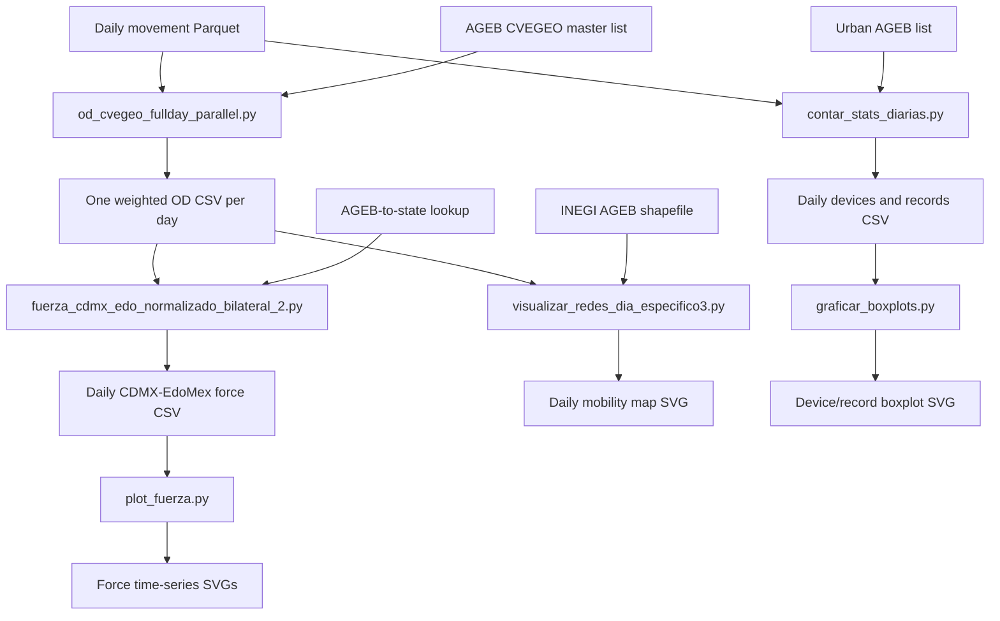

# Mobility Network and Device Summary Scripts

This package groups the main scripts into four stages. The first three stages build and visualize the **daily origin–destination (OD) networks**. The fourth is a separate branch that counts devices and raw records directly from the movement Parquet data and creates a monthly boxplot summary.

## Folder layout

```text
01_network_generation/
  od_cvegeo_fullday_parallel.py
02_force_timeseries/
  fuerza_cdmx_edo_normalizado_bilateral_2.py
  plot_fuerza.py
03_daily_network_map/
  visualizar_redes_dia_especifico3.py
04_device_summary/
  contar_stats_diarias.py
  estadisticas_diarias_movilidad_2020_2021.csv
  graficar_boxplots.py
requirements.txt
README.md
```

## Workflow overview



**The device-summary branch is independent of the OD-network branch.** It does not read the generated daily network CSVs.

## 1. Generate the daily OD networks

### `01_network_generation/od_cvegeo_fullday_parallel.py`

**Purpose:** reads daily movement Parquet data, filters records to a configured list of AGEB `CVEGEO` codes, orders observations by device (`caid`), identifies consecutive AGEB-to-AGEB transitions, and aggregates transition weights into a directed daily OD network.

**Current configuration in the script:**

- Parquet root: `/data/covid/aws/movement_parquet`
- AGEB list: `/data/shaday_data/GIT/movilidad/database/AGEB_CDMX_EDOMEX_INEGI_2020_COMPLETO.csv`
- Output folder: `/data/shaday_data/GIT/movilidad/output/redes_nuevas/`
- Date range: 2020-01-01 through 2021-12-31
- `DWELL_TIME = 0`

The daily output follows this naming pattern:

```text
ageb_od_cvegeo_YYYY_MM_DD_FullDay.csv
```

Expected columns include `source`, `target`, and `w`. In this implementation, `w` is scaled as:

```text
w = (number of qualifying transitions × 1,000,000) / distinct devices observed that day
```

Therefore, `w` is a scaled network weight, not necessarily a raw trip count.

Run from the project root after editing the configured paths for the machine where the source data is mounted:

```bash
python3 01_network_generation/od_cvegeo_fullday_parallel.py
```

## 2. Calculate and plot the CDMX–State of Mexico force series

### `02_force_timeseries/fuerza_cdmx_edo_normalizado_bilateral_2.py`

**Purpose:** reads every daily `*_FullDay.csv` in `redes_nuevas/`, maps each origin and destination AGEB to a state, and calculates the two directional flows:

- CDMX → State of Mexico
- State of Mexico → CDMX

It produces absolute weighted flows, each direction as a share of the valid mapped network total, and each direction as a share of the **bilateral flow between the two states**. When the bilateral total is non-zero, the two bilateral proportions sum to 1.

Required lookup: `agebs_cdmx_edomex.csv`, with `CVEGEO` and `state` columns. The current code compares the state values to the exact strings `Mexico City` and `State of Mexico`.

Output:

```text
/data/shaday_data/GIT/movilidad/output/fuerza_cdmx_edomex_nuevas_redes.csv
```

Run:

```bash
python3 02_force_timeseries/fuerza_cdmx_edo_normalizado_bilateral_2.py
```

### `02_force_timeseries/plot_fuerza.py`

**Purpose:** reads the force summary CSV and creates three time-series SVG charts: absolute force, each direction as a percentage of mapped network flow, and bilateral directional proportions.

The copy in this organized package has been adjusted to read:

```text
fuerza_cdmx_edomex_nuevas_redes.csv
```

This corrects a mismatch in the source ZIP, where `plot_fuerza.py` pointed to the older `fuerza_cdmx_edomex.csv` even though the new-network calculator writes a differently named file.

Output SVGs:

```text
plot_fuerza_absoluta.svg
plot_normalizado_total.svg
plot_normalizado_bilateral.svg
```

The output directory is hard-coded in the script. Run:

```bash
python3 02_force_timeseries/plot_fuerza.py
```

## 3. Render a map for one date

### `03_daily_network_map/visualizar_redes_dia_especifico3.py`

**Purpose:** reads one daily weighted OD CSV and an INEGI AGEB shapefile, draws the selected AGEB polygons and curved mobility arcs, and saves a dark-background SVG map.

Configuration to review before each run:

- `FECHA_OBJETIVO` (default: `2020_01_14`)
- `FILTRO_ENTIDADES = ["09", "15"]`
- `MIN_PESO_LINEA = 2` (the script displays edges with `w > 2`)
- `shapefile_path`

The selected daily CSV must exist as:

```text
/data/shaday_data/GIT/movilidad/output/redes_nuevas/ageb_od_cvegeo_<FECHA_OBJETIVO>_FullDay.csv
```

The script saves `mapa_arcos_legend_<FECHA_OBJETIVO>.svg` relative to the **current working directory**. Run it from the desired output directory, or edit `out_file` to use an absolute path.

## 4. Count daily devices and records, then draw boxplots

This is a separate raw-data summary—not an OD-network metric.

### `04_device_summary/contar_stats_diarias.py`

**Purpose:** counts, for each date and within the configured urban-AGEB list, the number of distinct devices (`devices = COUNT(DISTINCT caid)`) and the number of raw Parquet rows/pings (`records = COUNT(*)`). It writes `estadisticas_diarias_movilidad_2020_2021.csv` in the current working directory.

The source configuration uses:

- `/mnt/mobile_data/movement_parquet`
- `/home/ShadayGuerrero/CRASH/redes/ageb_cdmx_edomex_urbanos.csv`
- Date range: 2020-01-01 through 2021-12-31

These paths and the AGEB geography differ from those in the OD-network generator. Check that the geographic universes are intentionally different or align them before comparing figures.

### `04_device_summary/graficar_boxplots.py`

**Purpose:** filters the daily statistics to `status == "OK"`, converts devices and records to millions, groups observations by year-month, and creates two boxplot panels: observed devices and observed daily records.

The script reads `estadisticas_diarias_movilidad_2020_2021.csv` from the current working directory. A precomputed copy of that CSV is included in this folder, so the plot can be recreated without recounting Parquet if that table is the intended version. The script does not read the similarly named `_mx.csv` variant.

Run from this folder:

```bash
cd 04_device_summary
python3 graficar_boxplots.py
```

Output: `figura_resumen_dispositivos.svg`, saved in the current working directory. The source script's print message says “.png”, but its current `savefig` call writes SVG only. The included `contar_dispositivos_diarios.py` is not an alternative input for this graph: it produces only 2021 `total_caid` values and does not provide the `records` column required by the boxplot.

To recalculate the statistics from raw Parquet, edit `DATASET_ROOT` and `LOCATION_FILE` in `contar_stats_diarias.py`, then run it from this same folder before running `graficar_boxplots.py`:

```bash
cd 04_device_summary
python3 contar_stats_diarias.py
python3 graficar_boxplots.py
```

## Important data and execution checks

1. Keep `CVEGEO` values as strings and preserve leading zeroes in all lookup files and network inputs.
2. Confirm that the state lookup uses `Mexico City` and `State of Mexico`, or update the exact comparisons in the force calculator.
3. Confirm that the daily OD weights and the denominators in the force calculation have the intended interpretation; the network `w` is scaled by devices.
4. The network generator uses `LAG(..., -1)` to select the next observation. Validate this behavior with the installed DuckDB version; `LEAD(..., 1)` expresses that intention more explicitly.
5. The generator subtracts timestamps to form `dwell_time` and compares that result with the integer `DWELL_TIME`; validate interval/numeric comparison behavior in the installed DuckDB version before the full run.
6. Run the scripts on the data host: the original Parquet stores, shapefile, and AGEB/state lookup files are not included in this package. The bundled daily-statistics CSV is a sample/precomputed input, not the raw source data.
